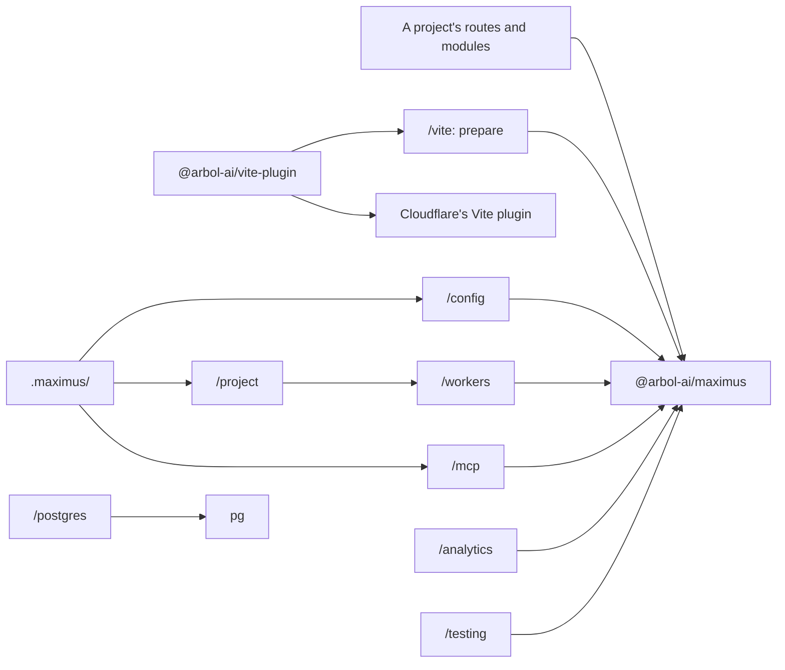

# Architecture

This page records why Maximus is built the way it is, and the boundaries it keeps. For how to use it,
start with [Concepts](concepts.md).

## Native fetch, no web framework

Maximus serves HTTP with the platform's own `Request` and `Response`. An exact index of methods and paths
finds each operation: no route scans, no regular-expression syntax for paths, no generated function bodies
and no framework-specific context objects. A method and path that no route declares answers `404`.

Maximus owns authorization, schema validation, failures as results, execution and native RPC. A web
framework would duplicate the transport layer around them and add a second router whose routes the contract
does not describe, which is why the lint preset refuses an import of `hono` or `elysia`. Elysia's
[Web Standard adapter](https://github.com/elysiajs/elysia/tree/main/src/adapter/web-standard), with its
contracts beside their handlers, and Hono's
[middleware composition](https://github.com/honojs/hono/blob/main/src/compose.ts), with its inferred chains
and its entry and exit middleware, inform the API; no source is copied or vendored.

Maintained implementations stay in their own packages: TypeBox for schemas, `jose` for JWTs, `ajv-formats`
for string formats and the official SDK for MCP. Maximus writes YAML itself, for its OpenAPI document and an
Agent Skill's frontmatter, with a small writer for JSON data.

Nothing compiles code at runtime. TypeBox checks values with its value checker, and the formats are plain
validators, so the framework runs in workerd without `eval`.

## Three packages, one version

| Package                 | What it holds                                                                            |
| ----------------------- | ---------------------------------------------------------------------------------------- |
| `@arbol-ai/maximus`     | The framework, one entry per concern, the `maximus` command and the Maximus Agent Skill. |
| `@arbol-ai/vite-plugin` | `maximus()`, the project's only configuration, which composes Cloudflare's Vite plugin.  |
| `create-maximus`        | `bun create maximus`: a new project from the `maximus init` of its own release.          |

The three are released together, at one version, so a project's packages always agree. Within
`@arbol-ai/maximus`, separation lives in the entries, and dependencies run in one direction:

- The root and the core entries never import an optional entry: Workers, MCP, Postgres or tooling.
  Optional entries depend toward the core.
- A provider's SDK lives only in its entry: the MCP SDK in `/mcp`, `pg` in `/postgres`. `/postgres` imports
  nothing else of Maximus.
- Runtime entries never import a command line, the process environment, templates or file-system code. The
  `maximus` command, `/vite` and `/testing` run in Node; the Worker never loads them.

The package is `sideEffects: false`, with explicit ESM exports and declarations, so a bundle carries only
what it imports. One build emits every entry: code that several entries share lives once, in a chunk they
import, so module state such as TypeBox's formats and the telemetry store exists once, and no entry loads
code it does not use. `pg`, the lint toolchain and Vite are optional peers. The release checks install the
packed package into a new project and confirm that installing it pulls in neither `pg` nor the lint
toolchain, that the browser entries reach no Node or Workers module, no MCP SDK and no Postgres driver, that
every Node entry loads, and that a new project passes its own `bun run verify`.

## Stable boundaries

- **Core**: results, schemas and the error catalog; verified principals and token policy; the builder,
  `defineHandler`, `defineTool`, `defineContext` and `defineAuth`; the one execution path; the native HTTP
  handler; the OpenAPI document; middleware; and the observer interfaces.
- **Workers**: `createWorker`, which serves an application as a Worker: its fetch handler, its RPC
  entrypoint, the instrumentation of the Worker's own entrypoints and Durable Objects, span annotations and
  static assets.
- **Project**: `/config` binds a project's files to the application, `/project` composes the generated
  Worker with its pages and event handlers, and `/vite` prepares a project from its files.
- **Optional entries**: protocols and drivers that only some services use: MCP, Postgres, analytics,
  webhook verification.
- **Services**: databases, credentials and sessions, customer policy, grants and provider parsing. A
  platform's control plane may be built with Maximus; it is never part of it.

## The build

### A service is a project

A service is a directory whose files declare it, configured by one file, `vite.config.ts`. Each convention
has one meaning: a file of `routes/` is one route, named by its path and method; a file of `mcp/tools/` is
a tool; `context.ts`, `errors.ts`, `auth.ts` and `telemetry.ts` complete the application in code;
`pages/`, `middleware/`, `crons/`, `queues/`, `email/` and `durable-objects/` are the Worker's other
parts; and `index.html` with `app/routes/` makes it a web app. [Project structure](guides/project-structure.md)
describes each one.

The layout replaces wiring code: nothing registers a route or mounts a module by hand, so a route cannot be
written and then forgotten, and two files cannot claim one path without the build saying so.

### `maximus prepare` and `.maximus/`

From `vite.config.ts` and the project's files, `maximus prepare` writes `.maximus/`, the modules that make
the project an application and a Worker:

| Module          | Holds                                                                                                                                                     |
| --------------- | --------------------------------------------------------------------------------------------------------------------------------------------------------- |
| `config.ts`     | What `vite.config.ts` states about the application, as data.                                                                                              |
| `middleware.ts` | The modules of `middleware/`, in filename order, apart by phase.                                                                                          |
| `env.d.ts`      | `Env`, inferred from the declared bindings by Cloudflare's own types; a binding to one of the Worker's own Durable Object classes is typed by that class. |
| `base.ts`       | The application builder: the configuration, `errors.ts`, `auth.ts`, `context.ts`, `telemetry.ts`, the MCP Markdown and the operation middleware.          |
| `register.d.ts` | The registration that types every handler's context, failures and bindings without importing the application.                                             |
| `app.ts`        | Every route and tool bound to that base, and the built application.                                                                                       |
| `worker.ts`     | The Worker: the application with its pages, cron, queue and email handlers, Durable Object classes, MCP and a web app's assets.                           |
| `http.ts`       | The API as the Worker serves it, without the Workers runtime, for tests in Node.                                                                          |
| `entry.ts`      | The stable entry Cloudflare's plugin builds.                                                                                                              |
| `mcp.ts`        | The MCP server's instructions, guides and skills, from the Markdown of `mcp/`, when there is any.                                                         |
| `app-routes.ts` | A web app's pages, from `app/routes/`, as React Router's routes.                                                                                          |

Preparation reads the project's modules and never runs them: it parses each file to find its declaration,
so preparing a project executes none of its code, and the file-system code that discovery needs stays out of
the Worker. It refuses what the Worker would refuse or never serve, before anything starts: two route files
for one method and path, a page on a path the API owns, a module named outside its convention, an import
that would make a cycle with the generated modules. A refusal names the file and leaves the previous
`.maximus/` as it was.

The plugin prepares the project before every build, when `vp dev` starts and whenever a project file
changes; `bun run typecheck` runs `maximus prepare` before `tsc`. `.maximus/` is generated and never
committed.

### Development and production

A project is prepared for `development` under `vp dev`, and under `vp test`, and for `production` in every
build and preview, whatever its Vite mode. Only a development build declares the development token's binding
and the policy that accepts it, and only it includes the modules named `.dev`; no deployed Worker can carry
either.

### The Vite plugin composes Cloudflare's

`maximus()` from `@arbol-ai/vite-plugin` is the project's configuration and its build. It derives the Worker
from the options: the generated entry, `nodejs_compat`, the bindings of the phase, where the Worker is served,
its observability, a trigger for each cron and queue module, and a web app's assets. Then it hands that
Worker to Cloudflare's Vite plugin, which runs it in workerd under `vp dev` and writes the Build Output that
`cf deploy --prebuilt` deploys. Cloudflare's names are the option names, so a Worker setting needs no
translation, and a `cloudflare.config.ts` beside it is refused rather than silently ignored.

Each tool owns its part: Vite+ develops, tests, lints and builds; Cloudflare's plugin owns the runtime and
the deployable build; Maximus owns what follows from the project's files. Under Vitest, `maximus()` leaves
Cloudflare's plugin out and resolves `cloudflare:workers` to a stand-in, so a project's tests run its API in
Node.

### Why the Worker stays small

A Worker's code is parsed by every isolate that runs it, so the build keeps what the Worker loads small:

- The Worker's build is minified, with a source map beside it.
- `mcp()` loads the MCP SDK with the first MCP request, from a chunk of its own: requests that are not MCP
  never evaluate it, and a project that serves no MCP does not include it.
- `/openapi.yaml` is written by Maximus's own YAML writer, so no YAML library is bundled. When the Worker
  serves MCP, the code both chunks use (TypeBox, `jose` and Maximus's core) sits in a third chunk, which the
  bundler names after its last module, often that writer: a `yaml-….js` in the build output is that chunk.
- Every entry is free of side effects: a Worker includes `/postgres`, `/analytics` or `/webhooks` only when it
  imports them.

## One execution path

Every transport converges on one function, which checks the caller's eligibility and token authority,
decodes the input, prepares the context, runs the middleware and the handler, and checks the result. Each
boundary therefore has one owner: an operation's input and output are checked once, for HTTP, MCP and RPC
alike, and the MCP SDK owns only JSON-RPC envelopes. Typed helpers inside the boundary never re-parse what
it checked; boundaries that are independently callable, such as an RPC method of your own, a provider's
response or a stored record, keep their own readers. No check is replaced by a cast, a trust flag or a
cache, and an output its schema refuses is never serialized.

## Request lifecycle

HTTP: origin pinning, when the Worker lists its origins → request middleware → the `before` hook → plain
routes and mounts → `/health` and the discovery documents → an exact route match, `404` before any token is
read → `aroundOperation` → token verification and scopes → the rate limit → the body, read within its limit
→ actor kinds and the input, decoded strictly → `context.ts` and each derivation → operation middleware on
the way in → the handler → operation middleware on the way out → the declared failures and the output check →
the response headers. A path outside the API and the protocols reaches the project's pages and a web app's
files.

MCP admits its endpoint as HTTP admits an operation, with the scope `<namespace>:mcp:use`, then lists the
caller's tools and runs each call through the shared path; every message of a JSON-RPC batch passes the rate
limit as a request of its own before any of them runs. Native RPC checks its binding's fixed props and the
forwarded principal, then executes.

Middleware is trusted application code, not another way to authenticate. Request middleware sees a copy of
the request without its body and no principal; operation middleware runs after admission, may answer a
declared failure instead of calling the handler, and cannot answer data its schema has not checked. Each
continuation runs once. A different authentication model belongs in a separately reviewed plain route,
never in a public bypass.

## Routing

Fixed routes are one map lookup. Templates such as `/v1/notes/{noteId}` compile, when the handler is built,
into deterministic states: one transition per segment, with no scan per request, so several hundred routes
cost nothing extra. Every segment is decoded before it is matched, so an encoded fixed segment reaches its
own route and never a sibling's parameter. A parameter occupies a whole segment and names a required string
field of the input. Ambiguous templates fail at construction, and a static segment wins over a parameter.
Paths are never normalized or redirected, and an unmatched path answers `404` before authentication, so
routing reveals nothing about authorization. A GET query field is read as its declared kind (integer,
number, boolean, list of strings, else string), repeated keys are refused, and JSON bodies are never coerced.

Routing semantics grow only with a concrete need and tests that keep the router and the OpenAPI document
in step; arbitrary regular-expression paths and route generators are deliberately absent.

## Tokens and tenancy

Every call has a principal with an organization. The default verifier maps organization-bound OAuth access
tokens; anything else goes through the application's own `resolve` in `auth.ts`, which must verify
cryptographically and return a strict principal. The framework owns no credential store, profile database or
permission list: an owner enforces client, environment, tenant activity and resource policy. Organization ids
never come from input, and annotations never authorize. The development token exists only in a development
build, and only from localhost.

## Behind a gateway

A gateway or reverse proxy in front of a service is one more HTTP caller. It forwards the caller's own token,
which the owner verifies for one of its audiences (`tokens.audience`) and decides exactly as any other HTTP
call; no header a proxy adds asserts anything on a caller's behalf. Services that call each other use native
RPC, whose binding props name the calling deployment. Every call reaches an owner through one of these two
paths.

## State and side effects

- A Durable Object owns serialized mutable state: sessions, credential promotion, rate and cooldown
  decisions.
- A Workflow owns one named, durable, multi-step operation whose effects are idempotent or reconciled.
- A queue owns durable asynchronous delivery with a real replay policy.
- A stateless helper needs none of them; `waitUntil` is best effort.

Uncertain writes are reconciled, never retried blindly: a credential submission, a paid task or a mutation
records its intent first, and answers `OUTCOME_UNKNOWN` when its result is lost. A provider's failure is a
failure, never an empty success. Services do not call each other in synchronous cycles.

## Telemetry and privacy

Observers are optional and isolated from the call and from one another. Only allowlisted execution metadata
reaches analytics, with the actor as a pseudonym unless a service chooses otherwise; no input or output,
credential, cookie or error message is recorded. Native logs name no actor or organization for a refused
request, and no organization is ever read from a token that was not verified. Durations are wall-clock
microseconds. Trace ids are never invented: without a real trace's id, the request id correlates. Turning off
Maximus's telemetry and turning off Cloudflare's own collection are separate controls.
[Observability](guides/observability.md) describes each record.

## Protocol scope

MCP uses the official SDK over Streamable HTTP, with one stateless server per request. It serves tools with
hints derived from their effects, in pages of 50; the OpenAPI document as resources; guides as resources and
prompts; and Agent Skills through the Skills extension. Instructions and annotations help agents; authorization
still depends on the token and its exact scopes. Sampling, elicitation, tasks, list-change notifications and
resumable subscriptions are not advertised, because services do not implement them. Read the
[current MCP specification](https://modelcontextprotocol.io/specification/latest) before adding a
capability, and keep transport validation and capability negotiation in the SDK.

## Versioning

The three packages share one version and follow semantic versioning: a breaking change moves the major
version, and the [changelog](../CHANGELOG.md) records each one. Published releases are immutable. A
service's deployed Durable Object class names, migration tags and durable keys are part of its contract:
reorganizing code must not reset stored state.

## Sources reviewed

- [MCP resources](https://modelcontextprotocol.io/specification/latest/server/resources) and
  [tools](https://modelcontextprotocol.io/specification/latest/server/tools).
- [MCP Skills extension](https://modelcontextprotocol.io/extensions/skills/overview) (SEP-2640).
- [Cloudflare context and `waitUntil`](https://developers.cloudflare.com/workers/runtime-apis/context/).
- [Workers best practices](https://developers.cloudflare.com/workers/best-practices/workers-best-practices/).
- [Auth0 organization-bound machine clients](https://auth0.com/docs/manage-users/organizations/organizations-for-m2m-applications).
- [RFC 9728, OAuth 2.0 Protected Resource Metadata](https://www.rfc-editor.org/rfc/rfc9728.html).
