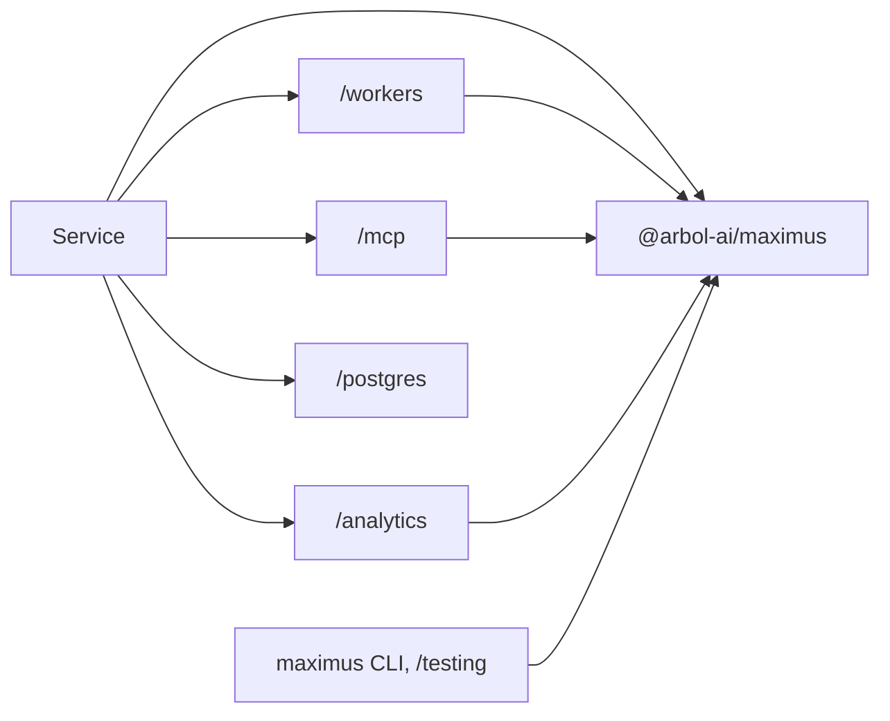

# Architecture

This page records why Maximus is built the way it is. For how to use it, start with
[Concepts](concepts.md).

## Native fetch, no web framework

Version 2 removed Elysia and Eden. Maximus already owned authorization, schema validation, `Result`
failures, execution and RPC; a web framework duplicated transport composition and, in workerd,
required a `Function` workaround. Native `Request` and `Response` plus an exact method and path index
serve fixed, versioned JSON routes with no route scans, no custom regular-expression syntax, no
generated function bodies and no framework-specific context objects. Unknown method and path
combinations fail closed.

We reviewed [Elysia's Web Standard adapter](https://github.com/elysiajs/elysia/tree/main/src/adapter/web-standard)
and [Hono's middleware composition](https://github.com/honojs/hono/blob/main/src/compose.ts).
Elysia's schema-adjacent contracts and Hono's inferred chaining and entry/exit middleware inform the
API. No source was copied or vendored. Maintained TypeBox, JOSE, YAML and MCP implementations remain
in their own packages: Maximus is not a replacement JWT verifier or MCP protocol implementation.

Nothing compiles code at runtime. TypeBox validates with its value checker, and formats use
maintained RFC validators, so the framework runs in workerd without `eval`.

## One package, entries in one direction

Maximus is one package, `@arbol-ai/maximus`, so a service adds one dependency and every part moves
on one version; a Vite+ project adds its build plugin, `@arbol-ai/vite-plugin`, released at that same
version. Separation lives in the package's entries instead:

Optional entries depend toward the core; the root and core entries import no MCP,
Postgres or Workers runtime code, and provider SDKs live only in their entry. `/postgres`
depends on nothing else in Maximus. The package is `sideEffects: false` with explicit ESM exports and
declarations, so a bundle carries only what it imports. tsdown builds every entry in one pass: each
entry is one file with its declarations, and code several entries share lives once in a chunk they
import, so module state (TypeBox formats, the telemetry store) exists once and no entry loads code it
does not use. `pg` and the lint toolchain are optional
peers, and the release checks verify that installing Maximus pulls in neither, that the browser
entries bundle without a Node or Workers runtime, and that each Node entry loads. The client imports the core's browser-safe body helpers and
the application only as a type. Runtime entry points never import a CLI, environment variables,
templates or file-system code. The core uses `node:async_hooks` only for invocation-local
diagnostics, under `nodejs_compat`.

## Stable boundaries

- **Core**: the `Result`, schema and error vocabulary, verified principals, the fluent definition,
  authorized execution, bounded native HTTP, runtime OpenAPI, middleware and neutral observer
  interfaces.
- **Workers**: the fetch handler, named native RPC, Durable Object instrumentation and native span
  annotations.
- **Optional entries**: optional SDKs and protocol details (MCP, Postgres).
  Observers may coexist; a failing one never changes a business result or suppresses another.
- **Services**: databases, credentials and sessions, customer policy, grants and provider parsing. A
  platform's control plane may use Maximus, but is never part of it.

## One execution path

Every transport converges on one function that checks actor eligibility and token authority,
decodes the input, prepares the context, runs middleware and the handler, and checks the result.
Validation therefore has exactly one owner per boundary: business input and output are checked once
for HTTP, MCP and RPC alike; the MCP SDK owns only JSON-RPC envelopes. Typed helpers inside the
boundary never re-parse, and boundaries that are independently callable (an RPC method of your own,
a provider response, a stored record) keep their own readers. Checks are never replaced with casts,
trust flags or caches, and unexpected output is never serialized.

## Request lifecycle

HTTP: origin pinning → `before` hook → plain routes and mounts → health and discovery → exact route
match (404 before any token is read) → `aroundOperation` → token verification and scopes → rate
limit → bounded body decoding → actor kinds and strict input decoding → derived context →
middleware entry → handler → middleware exit → declared result and output validation → response
headers. MCP admits its endpoint the same way, then filters and executes tools through the shared
path. Native RPC verifies its fixed caller props and the forwarded principal, then executes.

Middleware is trusted application code, not another authentication mechanism. It can short-circuit
with a declared `Result` but cannot emit unvalidated data, and `proceed()` may run once. Side effects
before authorization belong in the HTTP `before` hook; a different authentication model belongs in a
separately reviewed plain route, never in a public bypass.

## Routing

Fixed routes are one map lookup. Item templates such as `/v1/notes/{noteId}` compile into a
deterministic segment trie when the handler is built: one transition per segment, no per-request
scan, so several hundred routes cost nothing extra. A parameter occupies a whole segment and names a
required string input field. Ambiguous templates fail at construction; static segments win over
parameters. Paths are never normalized or redirected, and an unmatched path is `404` before
authentication, so routing reveals nothing about authorization. A GET query field is read as its
declared kind (integer, number, boolean, list of strings, else string), repeated keys are refused, and
JSON bodies are never coerced.

Add routing semantics only with a concrete requirement and parity tests across the router, OpenAPI
and the client; arbitrary regular-expression paths and route generators are deliberately absent.

## Tokens and tenancy

Every call has a principal with an organization. The default verifier maps organization-bound OAuth
access tokens; anything else goes through the application's own resolver, which must verify
cryptographically and return a strict principal. The framework owns no credential store, profile
database or permission list: an owner enforces client, environment, tenant activity and resource
policy. Organization ids never come from input, and annotations never authorize.

## Behind a gateway

A gateway or reverse proxy in front of a service is one more HTTP caller. It forwards the caller's own
token, which the owner verifies for one of its audiences (`tokens.audience`) and decides exactly as any
other HTTP call; no header a proxy adds asserts anything on a caller's behalf. Services that call each
other use native RPC with fixed caller props. Maximus 5.0 removed the earlier designs (unsigned
delegated grants, signed admission proofs and the service artifact), because every call now reaches
the owner through one of these two paths.

## State and side effects

- A Durable Object owns serialized mutable state: sessions, credential promotion, rate and cooldown
  decisions.
- A Workflow owns one named durable multi-step operation whose effects are idempotent or reconciled.
- A Queue owns durable asynchronous delivery with a real replay policy.
- A stateless helper needs none of them; `waitUntil` is bounded best effort.

Uncertain writes are reconciled, never retried blindly: credential submissions, paid tasks and
mutations record intent first and answer `OUTCOME_UNKNOWN` when their result is lost. A provider
failure is a failure, never an empty success. Services do not create synchronous call cycles.

## Telemetry and privacy

Observers are optional and isolated. Only allowlisted execution metadata reaches analytics; no input
or output, credential, cookie or error text is recorded. Native logs name no actor or organization
for rejected requests, and no organization is ever recovered from an unverified token. Durations
are wall-clock microseconds. Trace ids are never invented: the native span API exposes none today,
so correlation uses the request id. Disabling framework telemetry and disabling Cloudflare's own
collection are separate controls.

## Protocol scope

MCP uses the official SDK over Streamable HTTP, one stateless server per request. It serves tools
with effect-derived hints, 50-tool catalog pages, the OpenAPI document as resources, guides as
resources and prompts, and Agent Skills through the Skills extension. Instructions and annotations
help agents; authorization still depends on the token and exact scopes. Sampling, elicitation, tasks,
list-change notifications and resumable subscriptions are not advertised, because services do not
implement them. Read the [current MCP specification](https://modelcontextprotocol.io/specification/latest)
before adding a capability, and keep transport validation and capability negotiation in the SDK.

## Versioning

Maximus is one package with one version (4.0 merged the former `@arbol-ai/maximus-*` packages), and its
Vite plugin shares that version;
breaking changes move the major version (3.0.0 renamed every wire identifier). Published
releases are immutable. Deployed Durable Object class names, migration tags and durable keys are
part of a service's contract: reorganizing code must not reset stored state. See
[Migrating from 2.x](guides/migrating-from-v2.md).

## Sources reviewed

- [MCP resources](https://modelcontextprotocol.io/specification/latest/server/resources) and [tools](https://modelcontextprotocol.io/specification/latest/server/tools).
- [MCP Skills extension](https://modelcontextprotocol.io/extensions/skills/overview) (SEP-2640).
- [Cloudflare context and `waitUntil`](https://developers.cloudflare.com/workers/runtime-apis/context/).
- [Workers best practices](https://developers.cloudflare.com/workers/best-practices/workers-best-practices/).
- [Auth0 organization-bound machine clients](https://auth0.com/docs/manage-users/organizations/organizations-for-m2m-applications).
- [RFC 9728, OAuth 2.0 Protected Resource Metadata](https://www.rfc-editor.org/rfc/rfc9728.html).
