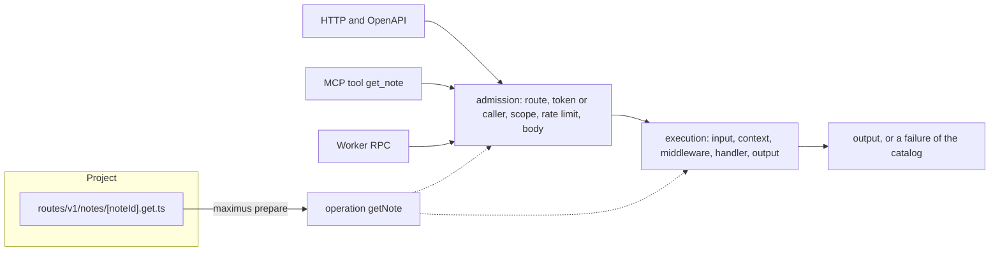

# Concepts

This page explains the model every Maximus service is built from, and fixes the words the rest of the
documentation uses. Read it after [Getting started](getting-started.md), or before it if you prefer the
model first.

## The model in one picture



A route file declares one operation: its contract and its handler. Every transport the contract opts
into admits its caller in its own way (an HTTP request by its access token, an MCP call by the same token,
an RPC call by the Worker that makes it) and then hands the input to one execution path, shared by all of
them. That path decodes the input, prepares the context, runs middleware and the handler, and checks what
comes back. A transport only translates the answer into its own wire format, so a rule written once holds
everywhere the operation is served.

## A service is a project

A Maximus service is a directory that Vite builds into one Cloudflare Worker:

```text
vite.config.ts      The only configuration: the application, its token issuer and its Worker
routes/             One file per route and method: the API
mcp/                Tools only agents call, and the Markdown that describes the MCP server
context.ts          What every handler receives besides its input
errors.ts           The service's own failures
src/                Domain code the routes share
tests/              Tests that call the API in Node
```

`maximus()` from `@arbol-ai/maximus/vite` reads `vite.config.ts` and the project's files on every
`vp dev`, `vp build` and `vp test`, and writes `.maximus/`: the Worker's entry, the application its routes
make, the `Env` type of its bindings and the types that check every handler. `.maximus/` is generated; you
never edit it, and it is not committed.

Besides `vite.config.ts`, every file and folder is optional. [Project structure](guides/project-structure.md)
describes each one, along with pages, middleware, scheduled handlers, queue consumers, email, Durable Objects
and a web app.

## Routes and operations

A route is a file whose name is its path and method, and whose default export is `defineHandler(handler,
contract)`:

```ts
// routes/v1/notes/[noteId].get.ts
import { defineHandler, UuidSchema } from '@arbol-ai/maximus';

import { NoteSchema } from '#src/notes.ts';

/** GET /api/v1/notes/{noteId}, also the MCP tool get_note: one note of the caller's organization. */
export default defineHandler(
  async ({ input, notes, fail }) => {
    const note = await notes.find(input.noteId);
    if (!note) {
      return fail('NOTE_NOT_FOUND');
    }
    return note;
  },
  {
    description: 'Read one note of the organization by its id.',
    input: { noteId: UuidSchema },
    output: NoteSchema,
    failures: ['NOTE_NOT_FOUND'],
    mcp: { name: 'get_note' },
  }
);
```

Maximus binds the file to its path, `GET /api/v1/notes/{noteId}`, and derives what the contract leaves
out:

| Derived   | From                                                        | Here               |
| --------- | ----------------------------------------------------------- | ------------------ |
| Operation | What the method does to what the path names                 | `getNote`          |
| Effect    | The method: `GET` reads, `DELETE` deletes, the others write | `read`             |
| Scope     | The service, the first fixed segment and the effect         | `notes:notes:read` |
| Title     | The operation's words as a sentence                         | `Get a note`       |
| Group     | The first fixed segment, in words: the OpenAPI tag          | `Notes`            |

The operation is the unit everything else refers to: its name is the OpenAPI `operationId`, the native
RPC method and the name in every log event. A contract may state any derived field itself;
[Route and operation options](reference/operations.md) lists them all.

The handler receives one object: `input`, decoded and checked against the contract's schema; the
verified `principal`; `env`, the Worker's bindings; `fail`, which answers a failure of the catalog; and
whatever `context.ts` prepares, here `notes`. It returns the output, or `fail(code)`.

## Transports

A route is always served over HTTP, under the API's base path, `/api` by default, and described in the
OpenAPI document at `/api/openapi.json`. Its contract opts it into the others:

- `mcp: { name: 'get_note' }` also serves it as an MCP tool at `/mcp`. A tool only agents call, with no
  HTTP route, is a file of `mcp/tools/`, declared with `defineTool`. See [MCP](guides/mcp.md).
- `rpc: true` also serves it as a method of the Worker's `Service` entrypoint, which other Workers of the
  same account call over a Service Binding. See [Worker RPC](guides/worker-rpc.md).

Exposure is always explicit: a route that names no tool is no tool, and a write is never exposed to agents
because a read is.

## Callers

Every call runs as a **principal**, the verified caller:

| Field            | Meaning                                                                  |
| ---------------- | ------------------------------------------------------------------------ |
| `actorId`        | Who acts: a person's subject, or a machine's client id.                  |
| `actorKind`      | `user` for a person, `service` for a machine client.                     |
| `organizationId` | The tenant the call acts for. It comes from the token, never from input. |
| `requestId`      | The id of this request, echoed in `x-request-id` and in every log event. |

Over HTTP and MCP the principal comes from an OAuth access token, which the Worker verifies against the
issuer `vite.config.ts` names. Over RPC it comes from the calling Worker, which the callee admits by name.
Under `vp dev`, the development token in `.dev.vars` stands in for an access token from `localhost`.
[Authentication and scopes](guides/authentication-and-scopes.md) covers each.

The **organization** is the unit of tenancy. Every store, query and key a handler touches is scoped by
`principal.organizationId`, and no input can name another organization: the notes store of Getting
started begins every key with it for that reason.

A **scope** is a permission the token must hold for the call to run: `<service>:<resource>:<read|write>`,
such as `notes:notes:read`, and `notes:mcp:use` to use the MCP server at all. The **effect** says what
an operation does (`read`, `write` or `delete`); it shapes the default scope and the hints MCP clients
read, and it never authorizes anything on its own.

## One execution path

A call goes through two stages, in this order, whichever transport carries it:

1. **Admission** decides whether the call may run: the route exists, the token is valid and holds the
   operation's scope, the caller is within the service's rate limit when it sets one, and the body is
   within the operation's limit. A call refused for its token, scope or rate limit never reaches your
   code, and its body is never read.
2. **Execution** runs it: the input is decoded and checked against the contract once, `context.ts`
   prepares the context, operation middleware wraps the handler, the handler answers, and the answer is
   checked against the contract's output, its declared failures and the output limit.

Nothing downstream re-validates what an earlier step checked, and nothing can skip a check: request
middleware (`middleware/`) runs before admission, sees no principal and cannot admit a caller, while
operation middleware runs after it.

## Answers and failures

A handler answers its output, or a **failure**: `{ code, message, retryable, data }`, created from the
**error catalog**. The catalog holds the [standard failures](reference/standard-failures.md) every
operation may answer, such as `INVALID_INPUT` or `RATE_LIMITED`, and the service's own, which `errors.ts`
declares with their HTTP status and message. Expected outcomes are answered with `fail(code)`; they are
never thrown.

When a contract lists its `failures`, they are the only domain failures the operation answers and the only
ones its OpenAPI entry documents. Anything else, a failure the operation did not declare, an output its
schema refuses or an exception, is the server's error: the caller receives `INTERNAL_ERROR`, never the
error's text, and the error is reported by its safe description. See
[Errors and results](guides/errors-and-results.md).

Over HTTP, every answer is one envelope:

```json
{ "success": true, "data": { "noteId": "…" }, "error": null, "metadata": { "requestId": "…" } }
```

MCP answers a tool's output as its `structuredContent` and a failure as a tool error; RPC answers a
`Result`, `{ ok: true, value }` or `{ ok: false, error }`. [Wire formats](reference/wire-formats.md) has
every shape.

## Schemas

Contracts are [TypeBox](https://github.com/sinclairzx81/typebox) schemas, exported as `t`. A schema is
three things at once: the check a value must pass at runtime, the TypeScript type of the value (`Static`),
and its description in the OpenAPI document and the MCP tool listing. Inputs and outputs are strict
objects (`additionalProperties: false`), so a field nobody declared is refused rather than ignored.

Data that comes back from storage is untrusted as well: `readSchema` checks it against its schema before a
handler uses it. See [Schemas and validation](guides/schemas-and-validation.md).

## Bindings and Env

A Worker reaches Cloudflare's services through bindings: a KV namespace, a D1 database, an R2 bucket, a
queue, another Worker. They are declared once, in `maximus()`'s `env`:

```ts
env: { NOTES: bindings.kv(), REMINDERS: bindings.queue({ name: 'reminders' }) },
```

The generated `Env` types them (`NOTES: KVNamespace`), so a binding the code reads but nobody declared is a
type error. [Bindings](guides/bindings.md) shows each kind, how its resource is created and how a test
stands in for it.

## The application underneath

Every project builds an **application**: its configuration and its operations, the object the generated
Worker serves. You can build one in code with the builder `maximus()` from `@arbol-ai/maximus`, and serve
it with `createWorker`, which is what `.maximus/` does for a project:

```ts
const app = maximus<Env>(configuration)
  .derive(async ({ env, principal }) => ok({ notes: noteStore(env.NOTES, principal.organizationId) }))
  .operation('getNote', definition, async ({ notes }, input) => {
    const note = await notes.find(input.noteId);
    if (!note) {
      return err(errors.noteNotFound.create());
    }
    return ok(note);
  })
  .build();
```

The builder is immutable, and `.build()` refuses an application that breaks a rule (a scope outside its
namespace, a mutation behind `GET`, a schema that is not strict) with a `TypeError` that names the rule,
so a misconfigured service fails when it starts, never on a request. Most services never write the builder
by hand; [Worker composition](guides/worker-composition.md) shows when and how.

## Glossary

| Term          | Meaning                                                                                         |
| ------------- | ----------------------------------------------------------------------------------------------- |
| Project       | A directory with `vite.config.ts` and route files that builds into one Worker.                  |
| Route         | A file of `routes/` that declares one operation with its path and method.                       |
| Tool          | An operation MCP serves: a route that names one, or a file of `mcp/tools/`.                     |
| Operation     | One named capability: a contract and a handler. Its name identifies it everywhere.              |
| Contract      | What a route declares besides its handler: schemas, failures, exposure, scope and limits.       |
| Handler       | The function that answers a call: its output, or `fail(code)`.                                  |
| Context       | What a handler receives besides its input: the invocation and what `context.ts` prepares.       |
| Principal     | The verified caller: `actorId`, `actorKind`, `organizationId` and `requestId`.                  |
| Organization  | The tenant a call acts for, from the verified token.                                            |
| Actor         | Who acts: a `user` (a person) or a `service` (a machine client).                                |
| Scope         | A permission the caller's token must hold: `<service>:<resource>:<action>`.                     |
| Authority     | The verified token behind an HTTP or MCP call: its scopes and client. RPC calls have none.      |
| Effect        | `read`, `write` or `delete`: what an operation does. It never authorizes.                       |
| Transport     | A way to reach operations: HTTP, MCP or Worker RPC.                                             |
| Admission     | The checks that decide whether a call may run, before any of your code does.                    |
| Failure       | `{ code, message, retryable, data }`, created from the error catalog.                           |
| Error catalog | The standard failures and the service's own, with their statuses: `errors.ts`.                  |
| Envelope      | The JSON body of every API response: `{ success, data, error, metadata }`.                      |
| Binding       | A Cloudflare resource the Worker reaches through `env`, declared in `maximus()`.                |
| Application   | The configuration and operations a Worker serves, built by a project or by the builder in code. |
