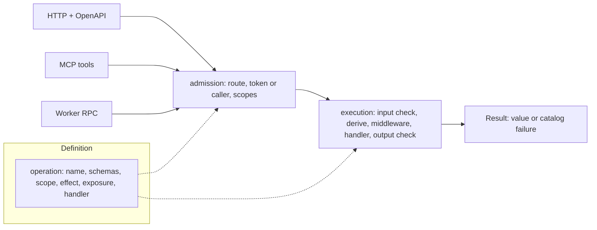

# Concepts

This page explains the ideas every Maximus service is built from and fixes the words the rest of the
documentation uses. Read it after [Getting started](getting-started.md), or before it if you prefer
the model first.

## The model in one picture



You declare an operation once. Each transport you opt into admits the caller in its own way, then
hands the decoded input to one shared execution path. That path validates the input, prepares the
context, runs middleware and the handler, and validates what comes back. A transport only translates
the result into its own wire format.

## Glossary

| Term            | Meaning                                                                                                                               |
| --------------- | ------------------------------------------------------------------------------------------------------------------------------------- |
| Application     | The object `.build()` returns: configuration plus operations. You pass it to `createWorker`, `createHttpHandler` and `createOpenApi`. |
| Builder         | The immutable object `maximus()` returns. Every `.operation()`, `.derive()`, `.use()` and `.mount()` returns a new builder.           |
| Base            | The single builder your service creates with `maximus()`. Resource modules extend it and are mounted back on it.                      |
| Resource module | A builder chain that declares the operations of one resource, usually in its own folder.                                              |
| Operation       | One named capability: a definition plus a handler. Its name is its stable identifier everywhere.                                      |
| Definition      | The object that declares an operation: schemas, scope, effect, exposure and limits.                                                   |
| Handler         | `async (context, input) => Result`: the function that implements an operation.                                                        |
| Context         | What a handler receives besides its input: the invocation plus everything `.derive()` added.                                          |
| Invocation      | The fields Maximus provides: `env`, `principal`, `authority`, `input`, `operation`, `background` and, for byte uploads, `body`.       |
| Principal       | The verified caller: `actorId`, `actorKind`, `organizationId` and `requestId`.                                                        |
| Organization    | The tenant. Its id always comes from the principal, never from input.                                                                 |
| Actor           | Who acts: a `user` (a person) or a `service` (a machine client).                                                                      |
| Scope           | A permission string, `<namespace>:<resource>:<action>`, that an operation requires.                                                   |
| Authority       | The verified scopes and client of the token behind a call (`context.authority`). Ordinary RPC has none.                               |
| Effect          | `read`, `write` or `delete`. It describes behavior; it never authorizes.                                                              |
| Transport       | A way to reach operations: HTTP, MCP or native Worker RPC.                                                                            |
| Exposure        | The parts of a definition that opt an operation into transports: `http`, `mcp` and `rpc`.                                             |
| Result          | `{ ok: true, value }` or `{ ok: false, error }`. Handlers return one; they do not throw expected failures.                            |
| Failure         | `{ code, message, retryable, data }`, created from the error catalog.                                                                 |
| Error catalog   | The object `defineErrors()` returns: the framework's standard failures plus yours, with their HTTP statuses.                          |
| Envelope        | The JSON body of every HTTP operation response: `{ success, data, error, metadata }`.                                                 |
| Plain route     | An HTTP handler outside token admission, for callers that cannot send a bearer token (webhooks).                                      |

## The application and the builder chain

```ts
const base = maximus<Env>(configuration); // one per service

const records = base
  .derive(async ({ env, principal }) => ok({ db: openDatabase(env, principal.organizationId) }))
  .use(async (context, proceed) => proceed())
  .operation('listRecords', definition, handler);

export const app = base.mount(records).build();
```

- `maximus<Env>(configuration)` creates the base. `Env` is the type of your Worker bindings.
- `.derive()` adds typed values to the context. It must come before any `.operation()` on its chain.
- `.use()` adds middleware that wraps the handlers of operations declared after it.
- `.operation()` declares one operation. It captures the chain's preparation and middleware at that
  point, so later `.use()` calls never change it.
- `.mount()` adds the operations of another chain built from the same base. Groups may have
  different contexts; a credential preparation in one group never runs for another group.
- `.build()` validates everything and returns the application.

Builders are immutable. Two modules can extend the same base without overwriting each other, and a
duplicate operation name fails when you mount it. Construction errors are `TypeError`s that state the
rule that was broken, usually with the operation's name, so a misconfigured service fails at
startup, not on a request.

There is no file-system discovery and no mutable registry. An operation exists because a module
declared it and `app.ts` mounted that module.

## Operations

An operation name is camelCase (`^[a-z][a-zA-Z0-9]*$`) and must not be a reserved Worker method name
(`fetch`, `connect`, `constructor`, `then`, `scheduled`, `queue`, `alarm`, `__proto__`,
`prototype`). The name is the OpenAPI `operationId` and the native RPC method name.

```ts
base.operation(
  'getNote',
  {
    scope: 'notes:notes:read',
    effect: 'read',
    title: 'Get a note',
    description: 'Read one note by its identifier.',
    input: t.Object({ noteId: t.String() }, { additionalProperties: false }),
    output: NoteSchema,
    http: { method: 'GET', path: '/v1/notes/{noteId}' }, // HTTP route and OpenAPI entry
    mcp: { name: 'get_note', idempotent: true }, // MCP tool
    rpc: true, // method on the Worker's named entrypoint
  },
  async ({ env, principal }, input) => {
    // ...
  }
);
```

Omit `http`, `mcp` or `rpc` to leave an operation off that transport. Something no caller reaches over
a transport is a plain helper function, not an operation. Every field is listed in the [operation reference](reference/operations.md).

The handler receives the decoded input and returns a `Promise` of a `Result`. Its input and output
types are inferred from the schemas, and its context type from the chain.

## Schemas and validation ownership

Schemas are [TypeBox](https://github.com/sinclairzx81/typebox) schemas, available as `t`:

```ts
import { t } from '@arbol-ai/maximus';

const NoteSchema = t.Object(
  { noteId: t.String(), text: t.String({ maxLength: 2000 }) },
  { additionalProperties: false }
);
```

Inputs and outputs must be strict objects (`additionalProperties: false`) or unions whose every
member is a strict object. A GET input is always one strict object, because it is the query string.
Extra fields are refused, so a caller cannot smuggle an `organizationId` into your input.

Validation has exactly one owner per boundary:

- **Operation input** is decoded and checked once, by the shared execution path, on every transport.
  Defaults are applied there, and so are owner codecs (normalization, refinements) when the input is
  compiled with `inputSchema`. The handler receives the decoded value and must not check it again.
- **Operation output** and returned failures are checked once, at the same boundary. An output that
  does not match its schema, or a failure that is not in the catalog, becomes `INTERNAL_ERROR`; the
  invalid value is never sent.
- **Everything else that crosses a trust boundary** has its own reader: stored records, provider
  responses, model answers, operator files and the input of an independently callable RPC method.
  Read those with `checkSchema` or `readSchema`.

Do not add casts, trust flags or no-op validators to skip a check, and do not validate twice. The
[schemas guide](guides/schemas-and-validation.md) covers codecs, query strings and readers.

## Principals, tokens and scopes

Every operation call has a verified principal:

```ts
interface Principal {
  actorId: string; // the token subject
  actorKind: 'user' | 'service';
  organizationId: string; // as the identity provider issues it: letters, digits, _ and -
  requestId: string; // a UUID minted for this request
}
```

On HTTP and MCP the principal comes from the bearer token. By default Maximus verifies an OAuth
access token against `tokens.issuer` and `tokens.audience`; a service with other credentials verifies
them in `tokens.resolve`. Either way, the token must carry an organization. Over native RPC the
calling Worker forwards the principal it verified, and the owner checks its shape. A call a gateway
forwards is an ordinary HTTP call carrying the caller's own token, which the owner verifies for one
of its audiences. Every tenant query uses `principal.organizationId`, never a value from input.

A scope is `<namespace>:<resource>:<action>`, where `namespace` is the application's `namespace`.
An operation declares one scope or a list; with a list, any one admits the caller unless the
operation sets `scopeMatch: 'all'`. Scopes are checked before the input is read. MCP additionally
requires `<namespace>:mcp:use` to open the endpoint.

`actorKinds: ['user']` or `['service']` limits who may execute an operation, independently of
scopes. `conditionalScopes` declares extra scopes a handler checks itself for part of an operation
(for example, managing another person's record); such an operation fails closed when there is no
token authority to check them against.

Two things never authorize: an effect, and `visibility: 'internal'`, which hides an operation from
public documents. See [Authentication and scopes](guides/authentication-and-scopes.md).

## Effects

`effect` is `read`, `write` or `delete`. It is a fact about the operation, used to:

- refuse GET for anything but a read (a read may still use POST, for example a search with a body);
- derive MCP annotations (`readOnlyHint`, `destructiveHint`).

An effect is not consent and not authorization. A write still needs business checks and an honest
answer when its outcome is uncertain.

## Results and failures

Handlers return a `Result`:

```ts
import { err, ok } from '@arbol-ai/maximus';

return note ? ok(note) : err(errors.noteNotFound.create());
```

Failures come from the application's error catalog:

```ts
const errors = defineErrors({
  noteNotFound: { code: 'NOTE_NOT_FOUND', status: 404, message: 'The note does not exist.' },
});
```

The catalog always contains the framework's standard failures (`INVALID_INPUT`, `UNAUTHORIZED`,
`FORBIDDEN`, `NOT_FOUND`, `RATE_LIMITED`, `INTERNAL_ERROR`, `OUTCOME_UNKNOWN` and others) and fixes
each code's HTTP status, retryability and `Retry-After`. Every transport presents the same failure:
an HTTP status and envelope, an MCP tool error, or the `Result` itself over RPC.

Throw only for the unexpected. A thrown exception becomes `INTERNAL_ERROR` and is reported to
diagnostics without its message. An outage is a failure, never an empty success. See
[Errors and results](guides/errors-and-results.md).

## derive, use and mount

- **derive** prepares typed context after admission and input validation, once per call. Return
  `ok({ ... })` to add fields or `err(failure)` to stop the call.
- **use** wraps execution. Middleware calls `proceed()` at most once and returns its `Result`, or
  returns its own `Result` to short-circuit. Middleware results are validated like handler results.
- **mount** composes resource modules built from the same base.

Middleware runs only after authentication, authorization and input validation; it cannot bypass
them. See [Middleware and context](guides/middleware-and-context.md).

## Transports

|                | HTTP                        | MCP                                     | Native RPC                            |
| -------------- | --------------------------- | --------------------------------------- | ------------------------------------- |
| Entry          | `@arbol-ai/maximus`         | `@arbol-ai/maximus/mcp`                 | `@arbol-ai/maximus/workers`           |
| Opt in         | `http: { method, path }`    | `mcp: { name, idempotent }`             | `rpc: true` or `{ callers }`          |
| Caller proves  | Bearer token                | Bearer token with `<namespace>:mcp:use` | Service Binding props `{ caller }`    |
| Scopes checked | Yes                         | Yes, also to list tools                 | No: the calling deployment is trusted |
| Principal from | Token                       | Token                                   | The caller, validated strictly        |
| Success        | 200/201/202 envelope        | `structuredContent`                     | `{ ok: true, value }`                 |
| Failure        | Catalog status and envelope | Tool result with `isError`              | `{ ok: false, error }`                |

All three share input validation, preparation, middleware, the handler and output validation.

HTTP also serves its own endpoints: `/health`, `/openapi.json`, `/openapi.yaml`, `/openapi.yml`, `/`
and the OAuth protected-resource metadata. See
[HTTP and OpenAPI](guides/http-and-openapi.md), [MCP](guides/mcp.md) and
[Worker RPC](guides/worker-rpc.md).

## The request lifecycle

For an HTTP operation, in order:

1. If `http.origins` is set, an unlisted origin is `NOT_FOUND`.
2. The `before` hook may answer the request.
3. Exact plain routes and prefix mounts answer their own paths.
4. Health and discovery endpoints answer without a token.
5. The router matches method and path exactly. No match is `NOT_FOUND`, before any token is read,
   and paths are never normalized (a trailing slash does not match).
6. `aroundOperation`, if configured, wraps the rest.
7. The bearer token is verified and the operation's scopes are checked (`UNAUTHORIZED`,
   `FORBIDDEN`).
8. The rate limit, if configured, is applied per organization and actor (`RATE_LIMITED`).
9. The body is read within its byte limit (`REQUEST_TOO_LARGE`) and decoded (`UNSUPPORTED_MEDIA_TYPE`,
   `INVALID_INPUT`).
10. Execution: actor kinds, input decoding, `derive`, middleware, handler, output check.
11. The response gets `x-request-id`, `cache-control: private, no-store` and
    `x-content-type-options: nosniff`.

MCP follows the same steps for its endpoint, then filters and executes tools through step 10. Native
RPC checks its binding props and the principal, then runs step 10.

## What Maximus does not do

Maximus supplies contracts, transports, verification, diagnostics and tooling. It is not a database,
a credential vault, a permission store or an integration catalog. Your service owns its storage,
credentials, business policy and provider protocols; Maximus gives each of them one clear place to
plug in.
